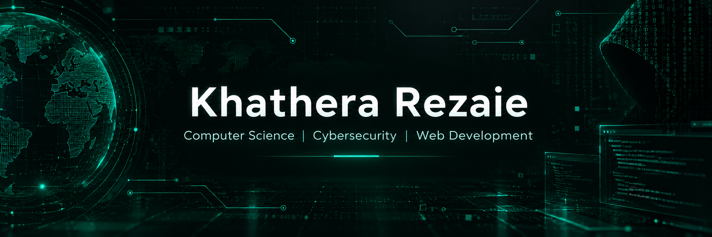

  

  

## About me

I'm **Khathera**, a **Computer Science undergraduate** at **Albukhary International University, Malaysia** (Class of 2027).

My interests span **software development, cybersecurity, and research**. I have experience in **full-stack web development** and programming, and I'm especially interested in **penetration testing** and understanding how systems can be made more secure.

Beyond technology, I've worked as a **primary school teacher** and **English and IT instructor**. Teaching, teamwork, and community initiatives have shaped how I communicate, collaborate, and approach problems.

## Technical skills

**Programming languages**

    

**Web development and tools**

    

**Cybersecurity tools and areas**

`Kali Linux` · `Nmap` · `Wireshark` · `Wazuh SIEM` · `Suricata` · `Network Enumeration` · `Threat Hunting` · `Penetration Testing Fundamentals`

## Research and interests

I work on **cybersecurity-related research papers** alongside my Computer Science studies. My research interests include **security awareness and education**, **software dependency vulnerabilities**, and practical approaches to improving cybersecurity.

I'm particularly interested in connecting **technical research** with **real-world security challenges**.

## Background beyond code

- **Education:** Former primary school teacher and English/IT instructor.
- **Leadership:** Experience in student and youth-led organizations, community initiatives, and event coordination.
- **Communication:** Teaching, public speaking, collaboration, and working across different backgrounds.

## Certifications and learning

- **IBM Cybersecurity Analyst Professional Certificate** (2026)
- **PCEP – Certified Entry-Level Python Programmer**
- Additional training in **web development, data analytics, and project management**

## Connect with me

  

